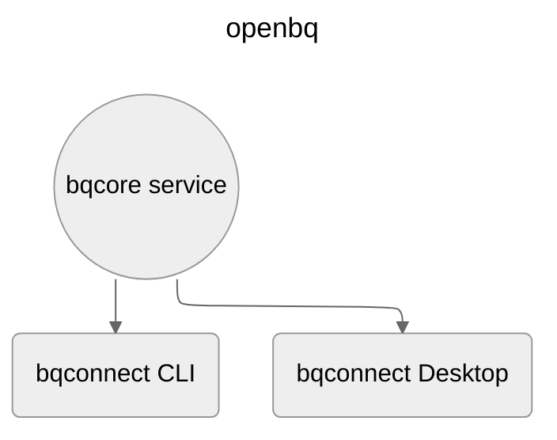
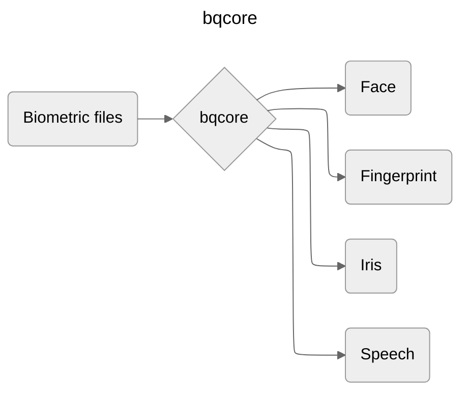
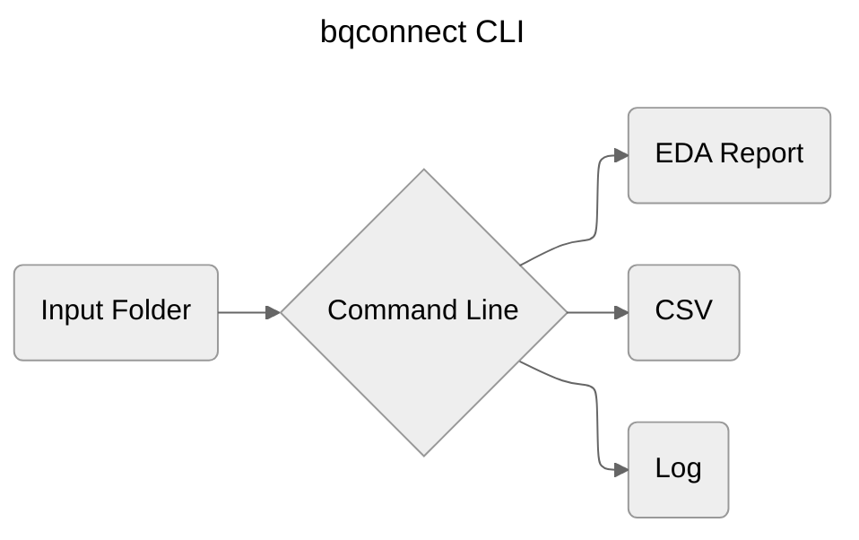
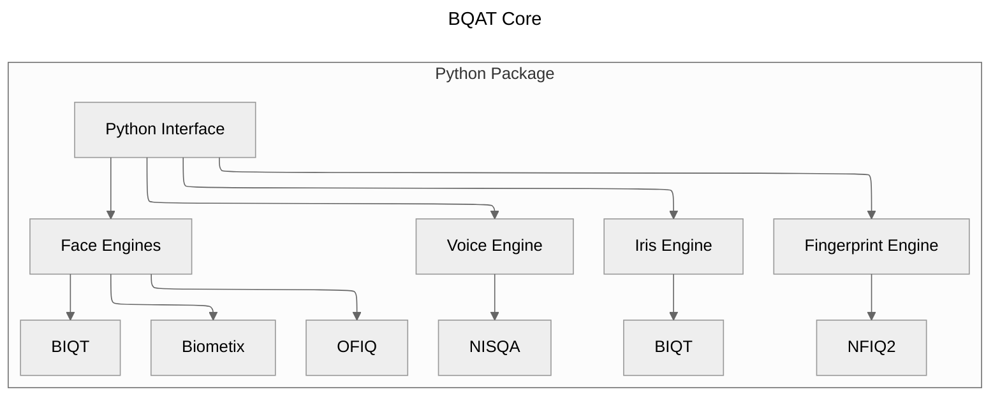
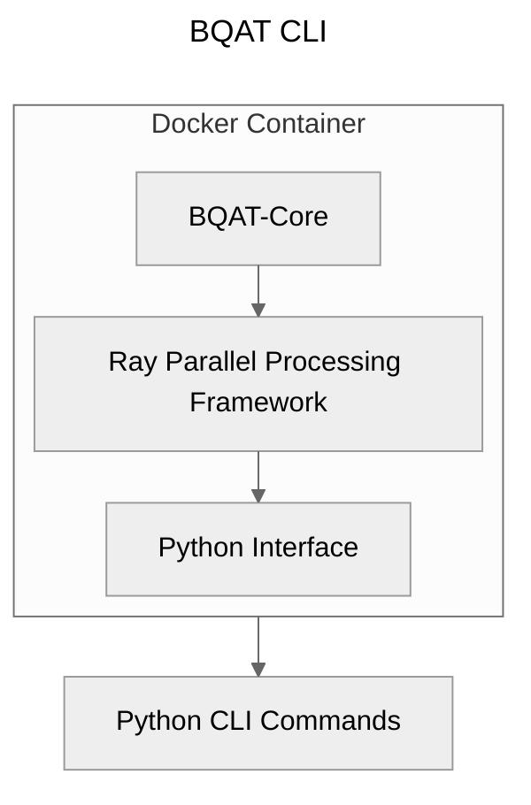
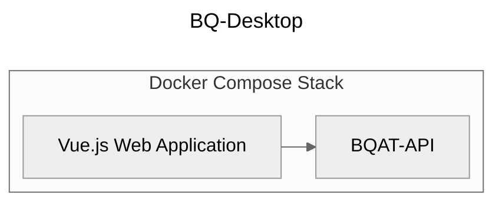
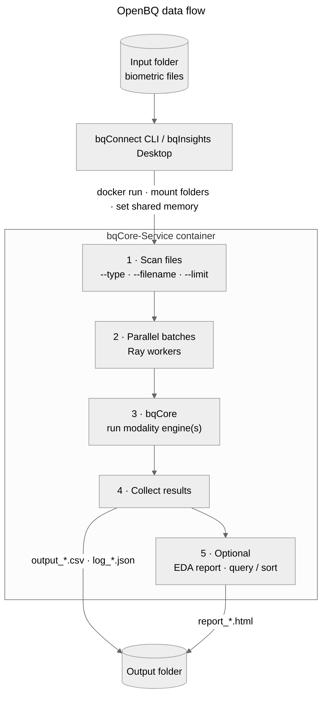
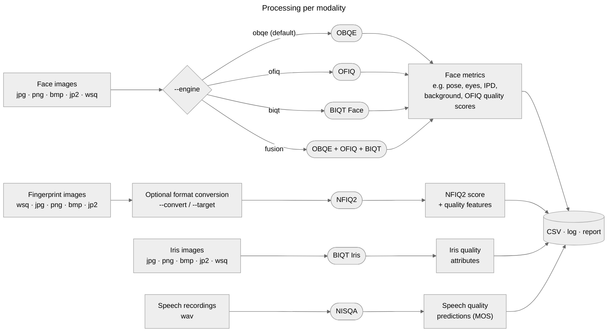
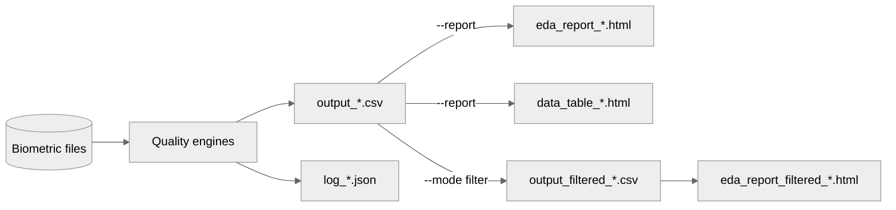

# Framework

---
<details open markdown="block">
  <summary>
    Table of contents
  </summary>
  {: .text-delta }
- TOC
{:toc}
</details>

---

## Project Diagram

 The openbq framework consists of the [bqcore](https://github.com/Open-Source-Biometric-Quality-Framework/bqCore) backend service, a [command line interface](https://github.com/Open-Source-Biometric-Quality-Framework/bqConnect-CLI), and a [desktop app](https://github.com/Open-Source-Biometric-Quality-Framework/bqConnect-Desktop).




### bqcore

The core component of openbq implement various vendor algorithms, including face, fingerprint, iris and voice processing engines. 

It will analyse the input biometric files and produce the quality metrics. 



### Interfaces

bqcore service is exposed via command line interfaces.

***



+ The bqconnect CLI provides terminal commands to interact with bqcore service.

+ It takes a folder in your file system as input and produces the raw metrics in CSV along with a EDA report.

+ It is distributed as Docker container as well as a Python entry point application.
## Solution Architecture



---


---

## Data Flow

OpenBQ takes a folder of biometric files, assesses each file inside the bqCore-Service container, and writes the results back to your machine.



| Step | What happens |
|---|---|
| Input | The CLI or Desktop app mounts your input folder into the container and sets shared memory. |
| 1 · Scan | Finds files matching the modality's supported types, plus any `--type`, `--filename` or `--limit` filters. |
| 2 · Parallel batches | Ray distributes files (or batches of files, for OFIQ, Fusion and speech) across CPU cores. |
| 3 · bqCore | Runs each file through the engine(s) for its modality (see below). |
| 4 · Collect | Writes one row of metrics per file to a CSV, plus a JSON log of any errors. |
| 5 · Optional | `--report` generates an HTML EDA report; `--columns`, `--query` and `--sort` filter the results. |
| Output | Results are saved to a timestamped folder inside the input folder, or to `--output`. |

### Processing per modality



| Modality | Input formats | Engine(s) | Output |
|---|---|---|---|
| Face | jpg, png, bmp, jp2, wsq | OBQE (default), OFIQ, BIQT Face, or Fusion of all three (`--engine`) | Face metrics, e.g. pose, eye state, inter-pupillary distance, background, OFIQ quality scores |
| Fingerprint | wsq, jpg, png, bmp, jp2 | NFIQ2, with optional format conversion (`--convert`, `--target`) | NFIQ2 score and quality features |
| Iris | jpg, png, bmp, jp2, wsq | BIQT Iris | Iris quality attributes |
| Speech | wav | NISQA | Speech quality predictions (MOS) |

## Reports

Every assessment produces a **results CSV**. With `--report`, OpenBQ also turns that CSV into an **EDA (Exploratory Data Analysis) report**, an HTML summary of the quality of the whole dataset.



### Results CSV schema

The results CSV has **one row per sample** and **one column per metric**. Every CSV follows the same structure:

| Column | Type | Present | Description |
|---|---|---|---|
| `file` | string | Always, first column | Path to the sample, relative to the input folder |
| Metric columns | number or string | Always | Quality scores and attributes from the engine(s). They depend on the modality and engine; see [Fingerprint](#output), [Face](#output), [Iris](#output) and [Voice](#output). |
| `error` | string | Only if a sample fails | Error message from the engine for that sample |

Format: comma-separated, UTF-8, with a header row. Missing values are left empty. Processing messages (e.g. format conversions) are written to `log_*.json`, not to the CSV.

#### Example: iris

A results CSV from an iris assessment (BIQT Iris), shortened to 4 samples:

``` csv
file,image_height,image_width,quality,contrast,iris_pupil_gs,iris_sclera_gs,iso_greyscale_utilization,iso_iris_pupil_concentricity,iso_iris_pupil_contrast,iso_iris_pupil_ratio,iso_iris_sclera_contrast,iso_margin_adequacy,iso_overall_quality,iso_pupil_boundary_circularity,iso_sharpness,iso_usable_iris_area,normalized_contrast,normalized_iris_diameter,normalized_iris_pupil_gs,normalized_iris_sclera_gs,normalized_iso_greyscale_utilization,normalized_iso_iris_diameter,normalized_iso_iris_pupil_concentricity,normalized_iso_iris_pupil_contrast,normalized_iso_iris_pupil_ratio,normalized_iso_iris_sclera_contrast,normalized_iso_margin_adequacy,normalized_iso_sharpness,normalized_iso_usable_iris_area,normalized_sharpness,pupil_circularity_avg_deviation,sharpness,iris_center_x,iris_center_y,iris_diameter,pupil_center_x,pupil_center_y,pupil_diameter,pupil_radius
data/iris/0001.jpg,400,533,27,57,23.1513,56,7.2763,96.7111,82.3529,45.3488,36.2162,100,100,97.1054,18.1121,99,1,0.3,0.9315,1,1,1,1,1,1,1,1,1,1,1,0.1235,114,266,195,172,268,197,78,39
data/iris/0002.jpg,400,533,55,62,22.6238,52,6.608,96.5627,83.2579,41.3043,33.3333,100,100,96.2118,8.0194,92,1,0.6,0.9262,1,1,1,1,1,1,1,1,1,1,1,0.1551,104,261,195,184,260,198,76,38
data/iris/0003.jpg,400,533,50,64,22.475,50,6.761,96.0379,81.2183,42.8571,31.1475,100,100,95.5775,3.5476,98,1,0.55,0.9247,1,1,1,1,1,1,1,1,1,1,1,0.1828,90,283,203,182,280,201,78,39
data/iris/0004.jpg,400,533,69,59,22.4,54,7.3606,93.3426,83.0189,43.1579,40,100,100,96.4113,7.5485,99,1,0.75,0.924,1,1,1,1,1,1,1,1,1,1,1,0.1319,95,241,219,190,247,221,82,41
```

Every column after `file` is described in the [Iris output table](#output).

[Download sample CSV]({{ '/assets/samples/output_iris_sample.csv' | relative_url }}){: .btn }

### EDA report

The EDA report is generated with [ydata-profiling](https://docs.profiling.ydata.ai/) from the results CSV. The `file`, `tag` and `log` columns are excluded from the statistics; every other column is profiled.

| Section | What it shows | Example use |
|---|---|---|
| **Overview** | Number of samples and metrics, missing values, duplicate rows, and alerts | Check how many samples failed to produce a score |
| **Variables** | For each metric: min, max, mean, median, standard deviation, histogram and most common values | See the spread of `quality` or `iso_overall_quality` across the dataset |
| **Correlations** | How strongly metrics move together | Confirm that low sharpness goes with low quality scores |
| **Missing values** | Which metrics are empty, and for how many samples | Spot samples an engine could not process |
| **Alerts** | Constant columns, highly skewed or extreme values, high correlations | Find systematic capture problems |
| **Sample** | The first and last rows of the data | Check values at a glance |

The **data table** (`data_table_*.html`) lists every row of the CSV, with each `file` linking back to the sample on your machine.

### How to generate them

``` sh
# Assess and report in one run
openbq --mode iris --input data/iris --report

# Report from an existing results CSV
openbq --mode report --input <path to output CSV>

# Report on outliers only
openbq --mode filter --input <path to output CSV> --query "iso_iris_pupil_ratio < 20 or iso_iris_pupil_ratio > 70"
```

All report files are saved in the same folder as the CSV.

## System Requirements

### Operating System

+ x86, ARM platform
+ Linux, Windows, macOS

> Since data processing is compute-intensive, you may want to allocate more cpu/memory with the host machine for better performance and stability.

### Runtime

openbq deliverables are packaged as Docker containers, you will need Docker engine to host the container.

### Performance Benchmark

Test Platform 1: 6/12 cores, amd64, Ubtuntu 25.10, 16 GB of RAM.

| Mode | Throughput (per second) \| (per hour) |
| --- | --- |
| Face (openbq) | 9.86 \| 35,496 |
| Face (OFIQ) | 1.02 \| 3,672 |
| Face (BIQT) | 3.75 \| 13,500 |
| Fingerprint (NFIQ2) | 7.16 \| 25,776 |
| Iris (BIQT) | 18.63 \| 67,068 |
| Speech (NISQA) | 0.77 \| 2,772 |

Test Platform 2: 14 cores, arm64, macOS 15.6.1, 32 GB of RAM.

| Mode | Throughput (per second) \| (per hour) |
| --- | --- |
| Face (openbq) | 53.94 \| 194,184 |
| Face (OFIQ) | 2.08 \| 7,488 |
| Face (BIQT) | 8.54 \| 30,744 |
| Fingerprint (NFIQ2) | 14.54 \| 52,344 |
| Iris (BIQT) | 40.14 \| 144,504 |
| Speech (NISQA) | 1.50 \| 5,400 |


> As new quality metrics added to the engine, the benchmark number above might not reflect the current status of the project.

