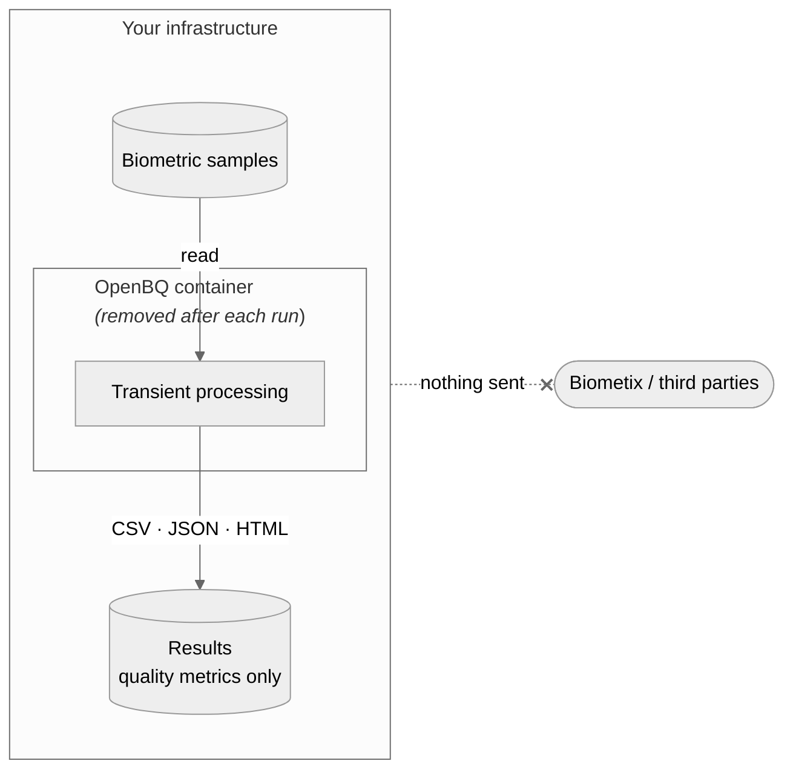

# Privacy and Data Handling

OpenBQ is built on privacy-by-design principles: biometric data stays on infrastructure you control, is processed only for as long as a run takes, and is never sent to Biometix or any third party. This page explains how OpenBQ handles data, what its outputs contain, and what deployers are responsible for.

---

## How OpenBQ handles data

- **Runs locally.** All processing happens in a Docker container on your own machine or server. OpenBQ does not upload biometric samples or results anywhere, and collects no telemetry.
- **Transient processing.** Samples are read from the folder you mount and assessed inside the container. Any temporary working copies are deleted when the run finishes, and the container is removed when it exits.
- **Samples are never copied into outputs.** OpenBQ writes only quality metrics and attributes, such as scores, measurements and detections. Images and recordings are not stored in or embedded in any output file.
- **No retention by OpenBQ.** OpenBQ keeps nothing after a run. Results are saved only in the folder you choose (see [Output](#output)), and how long they are kept is the deployer's decision.

## What the outputs contain

Results are quality metrics, not biometric samples. However, some output can still be personal information:

| Output | Why it may be personal information |
|---|---|
| `file` column (every modality) | The path to each sample. File names often contain names, ID numbers or dates of birth. |
| Face attributes (OBQE engine) | Estimated `age`, `gender`, `ethnicity`, `emotion` and `headgear_detection`. Linked to a sample, these may be sensitive personal information. |
| Reports and data tables | Built from the results CSV, so they contain the same information, and the data table links back to each sample. |

Store and share result files with the same care as the samples themselves.

{: .note }
> Estimated attributes are provided to help assess quality and capture conditions across a dataset (for example, checking whether quality differs between groups). They are estimates, not ground truth, and must not be used to identify or profile individuals.

## Use pseudonymous file names

Because results record the path to each sample, the safest approach is to remove identifying details from file names **before** running OpenBQ:

1. Rename each file to a neutral ID, e.g. `0001.jpg`, `0002.jpg`.
2. Keep the mapping between IDs and people in a separate, secured file that is not shared with the results.
3. Run OpenBQ on the renamed files.

Results can still be matched back to individuals when needed, using the mapping file, while the result files themselves contain no names or ID numbers.

## Configuration and models

Apart from your samples, OpenBQ uses only files bundled in its Docker image. None of these contain personal information, and OpenBQ downloads nothing at runtime.

| Import | What it is | Contains personal information? |
|---|---|---|
| OBQE models (`selfie_segmenter.tflite`, `hair_segmenter.tflite`, `haarcascade_smile.xml`) | Pre-trained models for background, hair and smile detection | No, model weights only |
| OFIQ configuration (`ofiq_config.jaxn`) and models | OFIQ engine settings and quality models | No |
| NISQA weights (`nisqa.tar`, `nisqa_tts.tar`) | Speech quality model weights | No |
| NFIQ2 and BIQT | Built into the engines | No |
| Built-in thresholds | Fixed values in the code, e.g. face detection confidence (0.7) | No |
| Your command-line settings | `--query`, `--config`, `--type` and other options | Only what you enter; used for that run and not stored |

## Deployer responsibilities

OpenBQ is a tool, not a service: Biometix never receives or processes your data. The organisation that deploys OpenBQ is the data controller and keeps full ownership, control and responsibility for compliance, including:

- **Lawful basis and consent** for collecting and assessing biometric samples
- **Notices** to the people whose samples are assessed
- **Access, correction and deletion requests** from those people
- **Security and retention** of samples and result files
- **Use of results**, including any decisions made from quality scores or estimated attributes

## Applicable laws

OpenBQ's local, transient design is intended to support deployers in meeting data protection laws such as:

- Australia: *Privacy Act 1988* and the Australian Privacy Principles (APPs)
- European Union: General Data Protection Regulation (GDPR) and the EU AI Act
- India: Digital Personal Data Protection Act 2023

Deployers should confirm which laws apply to their use. This page is not legal advice.

## Optional AI features (bqInsights Desktop)

The built-in AI assistant in bqInsights Desktop runs locally with [Ollama](https://ollama.com/) by default, so nothing leaves your computer. If you choose OpenAI or Claude as the AI provider instead, any data you send to the assistant is processed by that provider under its own terms. If you don't need AI features, you can leave them switched off.

## This documentation website

docs.openbq.io uses Google Analytics, with IP anonymisation enabled, to understand how the documentation is used. It does not collect biometric data. You can opt out with your browser's privacy settings or the [Google Analytics opt-out add-on](https://tools.google.com/dlpage/gaoptout).

## Contact

For privacy questions, contact [CONTACT EMAIL].
